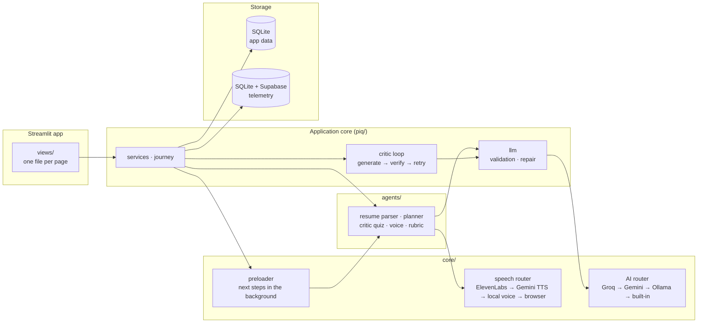

<div align="center">

<a href="https://github.com/prajwalparish-git/Skill-Scout-Nexus">
  <picture>
    <source media="(prefers-color-scheme: dark)" srcset=".github/assets/hero-dark.svg">
    
  </picture>
</a>

<p>
  <a href="https://github.com/prajwalparish-git/Skill-Scout-Nexus/actions/workflows/ci.yml"></a>
  
  
  
  
</p>

<p>
  <b>Profile a resume, close the skill gaps, practise under a critic's eye, and show the placement cell where the cohort stands.</b>
</p>

<p>
  <a href="#overview">Overview</a> ·
  <a href="#features">Features</a> ·
  <a href="#quick-start">Quick start</a> ·
  <a href="#configure-env">Configure .env</a> ·
  <a href="#running-locally">Running locally</a> ·
  <a href="#working-offline">Working offline</a> ·
  <a href="#how-it-works">How it works</a> ·
  <a href="#for-developers">For developers</a>
</p>

</div>

---

## Overview

Skill Scout Nexus is a placement-readiness coach for students across Engineering, Commerce,
Law, Management, Healthcare and Government roles. A team of AI agents reads a student's
resume against the role they want, plans what to study, sets quizzes and runs spoken mock
interviews. A critic agent checks every generated question and plan before the student sees
it, and quiz results shape the next week's plan. A university, college or corporate L&D team
gets an organization admin portal: bulk-create its students from a CSV, follow their progress
and export placement shortlists.

It runs on a laptop with nothing but Python. With no API keys at all it works in mock mode,
so every page can be tried offline; add a free Groq or Gemini key for live AI.

## Features

**The five-step placement journey**

| Step | What the student gets |
|:---:|---|
| **1. Onboarding and profile** | A resume (PDF, DOCX or TXT) against a target role: readiness score, skills found and missing, resume fixes. |
| **2. Resume scan and skill gaps** | The resume read against any role in any stream: required skills named, the gaps, the degree and stream it shows. |
| **3. 7-day study roadmap** | A day-by-day plan for the gaps with objectives, free resources and micro-tasks to tick off, saved week by week. |
| **4. Critic-checked quiz** | Questions on one skill, each checked for sound facts, a single right answer and fair options; a verified question bank fills any gap. |
| **5. Proctored voice assessment** | A spoken scenario question, a spoken or typed answer, a 0-15 rubric score, and flags for terse, off-topic or buzzword answers. |

**Organizations**

A university, an autonomous institute, a law or commerce college or a corporate L&D team creates
an organization (the admin confirms their email with a 9-digit code) and opens the **admin
portal**:

| Tab | What the admin gets |
|---|---|
| **Overview** | Enrolled, active, ready and average-score cards; a readiness funnel; students by tier; performance by main domain or subdomain; a skill-gap heatmap; score spreads and the weekly trend; top performers and who needs attention. |
| **Provisioning** | A CSV template, an upload preview (Ready, Duplicate, Invalid Email ...) with each student's role mapped from their domain, then **Provision accounts and send welcome emails** in one transaction. Every student gets a readable temporary password and a 9-digit code by email; the admin can also download the credentials once. Quick add for a single student. |
| **Students** | A searchable directory (domain, subdomain, account status, readiness tier) and a 360 profile per student: progress against the pass marks, skills and plan progress, every quiz with its topics, every voice session with its rubric and flags, a PDF progress report, and the actions: resend credentials, change domain or role, suspend or reactivate. |
| **Settings and drives** | The organization's profile and pass marks (quiz %, voice score); a placement drive shortlist (CSV) and an executive summary (PDF) for recruiters. |

Students of an organization sign in with the email and password they were sent, see their
organization and assigned domain in the sidebar, start on a profile already built from their
role's benchmark skills, and are offered a password of their own. An admin only ever sees their
own organization's students. **Try demo organization admin** on the sign-in page opens a fictional
organization with two dozen students across the four streams.

**More tools:** an adaptive weekly plan that follows quiz scores, a full quiz with its
step-by-step critic trail, a chat mock interview, an ATS resume builder with PDF export, a
project space for computing roles, and a personal dashboard.

**Built to keep working**

- **Self-healing AI.** Requests go to Groq first, then Google Gemini, then a local Ollama
  model, then built-in answers from the question bank. Several API keys can share the load
  in turn; a key that hits its rate limit rests while the next one answers.
- **No waiting between steps.** The moment a resume is scanned, the roadmap, the first quiz
  and the voice questions are written in the background, so each next step opens on a
  finished result.
- **Never blocks on the network.** Records are saved to a local SQLite database at once and
  copied to a cloud PostgreSQL (such as Supabase) in the background, catching up after an
  outage.
- **Your own account.** Sign in with a username or email, a password (PBKDF2-SHA256, 600,000
  rounds, salted) and a 9-digit code emailed to you; five wrong tries lock the account for 15
  minutes. You stay signed in across a browser refresh, and your scan, roadmap, quizzes and
  voice scores are where you left them.
- **No key prompts, ever.** Keys are read from `.env`; anything missing is skipped quietly
  (without email settings, codes go to a local outbox file for testing).
- **Accessible design.** Light and dark themes, readable on a phone and on a projector,
  self-hosted fonts so it works without internet.

## Quick start

You need **Git** and any **Python 3.8 or newer** (the setup fetches Python 3.13 if you lack it).

```bash
git clone https://github.com/prajwalparish-git/Skill-Scout-Nexus.git
cd Skill-Scout-Nexus
python bootstrap.py
```

`bootstrap.py` creates `.venv`, installs every dependency, makes `.env` from the template and
writes a launcher (`run.ps1` on Windows, `run.sh` on macOS and Linux). Then start the app:

| Windows (PowerShell) | macOS / Linux |
|---|---|
| `.\run.ps1` | `./run.sh` |

Open http://localhost:8501, sign up (or press **Continue with demo account**) and follow the
journey. With no keys it runs in mock mode, so every page can be tried offline.

<details>
<summary>Manual setup instead</summary>

You need **Python 3.13**.

```bash
python -m venv .venv
```

| Windows (PowerShell) | macOS / Linux |
|---|---|
| `.venv\Scripts\Activate.ps1` | `source .venv/bin/activate` |

```bash
pip install -r requirements.txt
```

| Windows | macOS / Linux |
|---|---|
| `copy .env.example .env` | `cp .env.example .env` |

```bash
streamlit run app.py
```

</details>

## Configure .env

Only **Groq and/or Gemini** are needed for cloud AI; everything else is optional and falls back
on its own.

1. Get a free key from [Groq](https://console.groq.com/keys) or [Google AI Studio](https://aistudio.google.com/apikey) (or both).
2. Put it in `.env` and turn off mock mode:

```ini
MOCK_MODE=false
GROQ_API_KEYS=gsk_your_key            # several keys: gsk_key1,gsk_key2,gsk_key3
GEMINI_API_KEYS=AIza_your_key         # optional second provider, also comma-separated
```

| Key | What it does | If left blank |
|---|---|---|
| `GROQ_API_KEYS` | The fastest cloud AI, and speech-to-text for spoken answers | Skipped |
| `GEMINI_API_KEYS` | A second cloud AI | Skipped |
| `OLLAMA_BASE_URL`, `OLLAMA_MODEL` | A local model that works without internet ([ollama.com](https://ollama.com), then `ollama pull llama3.2:3b`) | Skipped |
| `GEMINI_TTS_MODEL`, `GEMINI_TTS_FALLBACK_MODEL` | Gemini speaks the interview questions with the Gemini key (the ElevenLabs alternative) | The PC's own voice, then the browser's |
| `ELEVENLABS_API_KEY` | ElevenLabs speaks the interview questions instead (optional) | Gemini TTS, then the PC's own voice, then the browser's |
| `LOCAL_STT_MODEL` | Transcribes spoken answers on this machine with no internet (see [Working offline](#working-offline)) | Groq or Gemini transcribe them online; otherwise the student types |
| `SUPABASE_DB_URL` | A cloud copy of all records (organizations, students and their results), kept in step in the background | Records stay on this machine |
| `SMTP_EMAIL`, `SMTP_APP_PASSWORD` | Emails the 9-digit codes and an organization's welcome emails (Gmail with an App Password) | Codes and credentials go to `data/.mail_outbox.log` on this machine |

The model names in `.env.example` are current (model IDs live only in `.env`, never in code);
every option is explained in that file. Never commit `.env`.

## Running locally

There are two front ends over the same services and the same `.env`: the Streamlit app (full
product, including organization admin) and a Next.js web app (the animated marketing site, a
redesigned dashboard, quiz, mock interview, study plan and resume builder).

### Streamlit app

```bash
streamlit run app.py
```

Then open **http://localhost:8501**.

Create an account (a 9-digit code confirms your email), or press **Continue with demo account**
to see a returning student with four weeks of fictional history; it is set up on first use. For
organizations, press **Try demo organization admin** (also set up on first use), or create your
own under **Organization admin access**. To rebuild the demo organization:

```bash
python -m scripts.seed_cohort --replace    # the fictional demo organization and its students
```

### Next.js web app

The API (step 1) and the Next.js dev server (step 2) each run in their own terminal, both from
the repo root created by [Quick start](#quick-start):

**1. Start the API**, reading the same `.env` as the Streamlit app:

| Windows (PowerShell) | macOS / Linux |
|---|---|
| `.venv\Scripts\python -m uvicorn server:app --port 8000` | `.venv/bin/python -m uvicorn server:app --port 8000` |

**2. Start the front end** (first run only: `npm install` once inside `frontend/`):

```bash
cd frontend
npm install        # first run only
npm run dev
```

Open **http://localhost:3000** — accounts are still created in the Streamlit app at
`:8501` (sign up, then upload a resume); the Next.js app reads the same students and data.

If the API needs a different `NEXT_PUBLIC_API_URL`, set it in `frontend/.env.local`; if the front
end runs on another address, list it in `FRONTEND_ORIGINS` in `.env` (comma-separated).

> **Local use only.** The API has no sign-in of its own: any caller that can reach it can read
> and write any student's records by id. Keep it on `localhost` (or behind your own
> authentication); the Streamlit app is the one with accounts.

<details>
<summary><b>Optional: check your Groq models before a demo</b></summary>

<br>

```bash
python -m scripts.check_models
```

It confirms the configured models are still served, answer in JSON and have quota left.

</details>

## Working offline

Nothing has to be switched: each tier is skipped on its own when it has no key or no network.

| Part | Order |
|---|---|
| AI text | Groq → Gemini → Ollama (local model) → built-in answers from `data/` |
| Voice out | ElevenLabs → Gemini TTS → the PC's own voice (pyttsx3) → the browser's voice |
| Voice in | Groq Whisper → Gemini → faster-whisper (local) → the student types |

For the local tiers, once, while online:

```bash
pip install -r requirements-offline.txt    # pyttsx3 and faster-whisper (optional)
ollama pull llama3.2:3b                    # after installing Ollama from ollama.com
python -m scripts.offline_setup            # downloads the speech model, then says what is ready
```

Set `OLLAMA_MODEL` and `LOCAL_STT_MODEL` in `.env` to the models you pulled.

## How it works

<div align="center">
  <picture>
    <source media="(prefers-color-scheme: dark)" srcset=".github/assets/layer3-dark.svg">
    
  </picture>
</div>



| Layer | Built with |
|---|---|
| Interface | Streamlit 1.66 with Altair charts; optional Next.js 14 over FastAPI |
| Agents | LangGraph generate → verify → retry loop; every AI answer is a validated Pydantic model |
| AI | Groq and Google Gemini (round-robin key pools), local Ollama, built-in answers |
| Voice | ElevenLabs, Gemini TTS, the PC's own voice or the browser's Web Speech API; Whisper on Groq, Gemini or faster-whisper (offline) for transcription. `python -m scripts.offline_setup` checks the no-internet setup |
| Storage | SQLite for the app; telemetry on local SQLite with a background copy to Supabase PostgreSQL |

## For developers

```
app.py              Streamlit entry point: settings check, session gate, navigation
server.py           FastAPI over the same services, for the Next.js front end
views/              One file per page; thin, no business logic
piq/                Application core: services, journey, accounts, organizations, LLM gateway,
                    prompts, checks, formatting and charts (only piq/ui.py imports Streamlit)
agents/             The journey's agents: resume parser, planner, critic quiz, voice, rubric
core/               Self-healing routers: AI, speech, transcription, preloader, mail, auth
database/           Telemetry: local SQLite with a background copy to PostgreSQL
data/               Catalog, role skills, degrees, interview tracks, question bank, samples
scripts/            Seeding, model checks, offline setup, CI checks and dev tools
evaluation/         The frozen baseline-vs-agents evaluation and its report
frontend/           Optional Next.js 14 front end
```

Before opening a pull request, run what CI runs:

```bash
ruff format --check .
ruff check .
python -m scripts.ci_check         # every module compiles, datasets agree, every page renders
cd frontend && npm run typecheck && npm run build   # if you changed the front end
```

Conventions: views call `piq` (never `agents`, `core` or `database` directly), all SQL lives in
`piq/db.py`, constants in `piq/config.py`, prompts in `piq/prompts.py`, every AI answer is a
validated Pydantic model, and a new dependency needs a pinned version and a one-line reason in
`requirements.txt`. Commits follow Conventional Commits (`feat(scope): ...`, `fix(scope): ...`).

## Privacy and legal

Skill Scout Nexus is a free, non-commercial, open-source academic college mini-project, provided
as is for educational and career-readiness purposes. Whoever runs a copy holds its data. The web
front end has a Privacy Policy, Terms of use and Cookies Policy (`/privacy`, `/terms`, `/cookies`),
asks for consent before optional browser storage, and loads no third-party scripts, fonts or embeds.
A student deletes their account and all of its history from the Onboard page (**Delete my
account**).

## Open Source Credits & Asset Licenses

Only original project artwork, open-licensed fonts and icons, and open-source libraries are used.

| Asset or library | Licence |
|---|---|
| Brand mark, wordmark (`static/brand/`) and README illustrations (`.github/assets/`) | Original artwork made for this project |
| Bricolage Grotesque, Atkinson Hyperlegible Next, JetBrains Mono (`static/fonts/`, `frontend/app/fonts/`) | SIL Open Font License 1.1, `OFL.txt` beside each font |
| Lucide icons (`lucide-react`) | ISC |
| GitHub mark | Used only to link to the repository, per GitHub's logo guidelines |
| Next.js, React, Motion, Lenis, Tailwind CSS, clsx, tailwind-merge | MIT |
| Streamlit, Groq SDK | Apache-2.0 |
| FastAPI, LangGraph, Pydantic, SQLAlchemy, python-docx | MIT |
| pandas, Altair, pypdf, python-dotenv, httpx, Uvicorn | BSD-3-Clause |
| fpdf2 | LGPL-3.0-or-later (used as an unmodified library) |
| psycopg (optional PostgreSQL driver) | LGPL-3.0 (used as an unmodified library) |

The study library on the plan page links to books and repositories that belong to their authors;
nothing from them is copied into the app.

<div align="center">
<br>
<sub>Built with Streamlit, LangGraph and Pydantic · runs offline in mock mode · <a href="https://github.com/prajwalparish-git/Skill-Scout-Nexus">github.com/prajwalparish-git/Skill-Scout-Nexus</a></sub>
</div>
